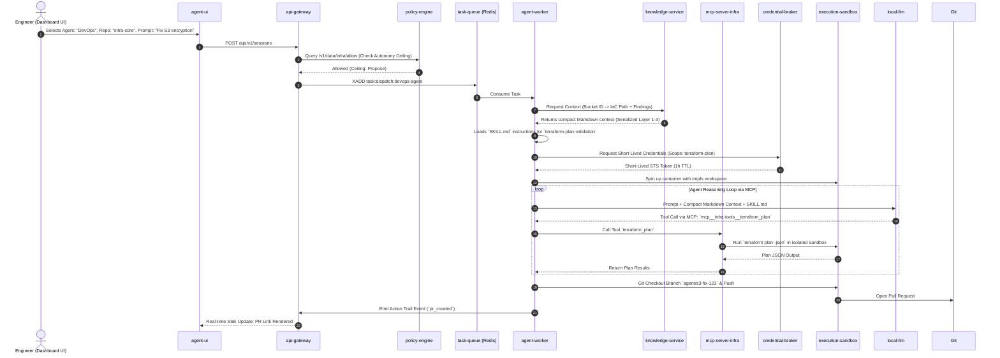

# Infrastructure Agent Architecture Blueprint & Local Setup Guide

> An end-to-end operational blueprint, single-table container reference, directory structure, software stack, sequence workflows, and local deployment guide covering Skills (`SKILL.md`), Knowledge/Data Plane, and MCP Servers.

---

## 1. Chapter Implementation Summary & Key Steps

Below is the summary table detailing the core focus, key architectural concepts, and mandatory implementation steps across all 13 chapters of the reference architecture.

| Chapter # & Title | Focus Area | Core Key Concepts | Key Implementation Steps |
| :--- | :--- | :--- | :--- |
| **01. Architecture Overview** | System-wide structural design | • Six core planes: Ingestion, Policy, Execution, Integration, Change Control, Observability<br>• Autonomy dial & ceilings (Off, Observe, Propose, Governed)<br>• Worker statelessness | 1. Implement a unified Signal Router for webhooks, schedules, and chat.<br>2. Build a Policy Engine gate before execution.<br>3. Decouple stateless workers from stateful DBs via queues. |
| **02. Agent Runtime & Orchestration** | Task queuing & execution loops | • SDK selection (Claude Agent SDK, OpenAI, LangChain, Custom)<br>• Consumer groups & PEL recovery<br>• Context compaction & session persistence | 1. Set up double-stream queues (Dispatch & Output streams).<br>2. Implement worker heartbeat monitoring & stuck-task watchdogs.<br>3. Build state recovery using git bundles & session IDs. |
| **03. Tools, CLIs & Skills** | Capability delivery & extension interfaces | • CLI tools vs. typed wrappers<br>• Agent Skills format (`SKILL.md` progressive disclosure)<br>• MCP & A2A 1.0 protocol standards | 1. Package CLI tools inside sandbox container images.<br>2. Create typed JSON wrappers for high-risk CLI commands.<br>3. Define structured `SKILL.md` files and attach per-session MCP servers. |
| **04. Sandboxed Execution** | Runtime isolation & security boundaries | • Container ephemerality & microVM sandboxing<br>• Network egress restrictions<br>• Blocking metadata endpoint (`169.254.169.254`) | 1. Provision ephemeral sandboxes (Docker, Modal, MicroVMs).<br>2. Enforce strict egress rules (block cloud metadata endpoints).<br>3. Implement lease-based orphan sweeper and sandbox recovery. |
| **05. Credential Management** | Just-in-time access control | • "No long-lived credentials in workers" rule<br>• Scoped JIT credential brokering<br>• Dynamic cloud token minting | 1. Build a Credential Broker service separate from workers.<br>2. Set up cloud token exchange (AWS STS, Azure Workload Identity, GCP IAM).<br>3. Restrict generated tokens to short TTLs ($\le 1$ hour) and read-only defaults. |
| **06. The Data Plane** | Knowledge serialization & retrieval | • Five context layers (Cloud, IaC, Security, Cost, Org)<br>• Cloud-to-IaC correlation<br>• Compact Markdown context serialization | 1. Collect and store normalized resources in a central DB.<br>2. Link cloud resource IDs to Terraform state/repo paths.<br>3. Serialize context into compact Markdown for LLM prompt injection. |
| **07. Change Control & GitOps** | Safe infrastructure deployment pipelines | • PR-first workflow constraint<br>• Pre-PR validation & zero-drift loops<br>• Deterministic static checks | 1. Enforce branch creation for all automated changes.<br>2. Run static linters & security scanners (Checkov, TFLint, Conftest).<br>3. Execute `terraform plan` feedback loop up to $N$ iterations before PR creation. |
| **08. Policy & Guardrails** | Access boundaries & automated gates | • Three guardrail layers (Structural, Prompt, Runtime)<br>• Governed Merge/Apply gateways<br>• Natural language policy compilation | 1. Enforce runtime tool allow/deny lists (deny always wins).<br>2. Build server-owned merge/apply gateways with blast-radius limits.<br>3. Generate structural policies (OPA/Rego, SCPs) from markdown rules. |
| **09. Observability & Audit** | System transparency & failure debugging | • Action Trails (event sourcing)<br>• OpenTelemetry GenAI semantic conventions<br>• Automated log redaction | 1. Instrument worker & LLM turns with OpenTelemetry spans.<br>2. Emit immutable Action Trail events to dedicated streams.<br>3. Apply pattern-matching regex redaction for all output logs. |
| **10. Autonomous Operations** | Unattended execution & alert handling | • Four-level autonomy dial (Reactive to Goal-driven)<br>• Durable session goals & single ownership<br>• Multi-channel escalation chains | 1. Implement scheduled triggers (CronJob / EventBridge).<br>2. Set up single-owner dispatch locks & cadence budgets per goal.<br>3. Route alert notifications via Slack, Teams, Email, or PagerDuty. |
| **11. Testing & Hardening** | Verification & vulnerability defense | • Four testing levels (Unit, Trajectory, Adversarial, Evals)<br>• Prompt injection resistance<br>• Concurrency race testing | 1. Write unit tests for skills, tools, and the credential broker.<br>2. Implement trajectory scenario recorders to test multi-turn flows.<br>3. Run adversarial prompt injection tests against IaC files. |
| **12. UX, Usability & Onboarding** | Adoption enablement & tenant boundaries | • Safe defaults by design<br>• Organization-level multi-tenancy<br>• Quick Connect (OIDC / Role delegation) | 1. Enforce organizational boundaries on all DB queries.<br>2. Implement progressive disclosure during onboarding.<br>3. Provide pre-built prompt templates for common IaC tasks. |
| **13. Risk Framework & Checklists** | Promotion ladders & regulatory alignment | • Autonomy promotion ladder<br>• Compliance mapping (NIST AI RMF, OWASP, SOC 2)<br>• Go-live verification checklists | 1. Assess risk matrix to assign initial autonomy levels per use-case.<br>2. Implement shadow-mode evaluation to measure PR merge rates.<br>3. Complete Phase 1–4 go-live security and governance checklists. |

---

## 2. All Containers Reference Table (Including MCP & Knowledge Services)

Below is the single reference table defining every container in the architecture, including dedicated services for **MCP tool bridging** and **Knowledge/Data Plane indexing**:

| Container Name | Plane / Category | Base Image / Software | Port(s) | Volumes / Storage | Purpose & Detailed Operational Role |
| :--- | :--- | :--- | :--- | :--- | :--- |
| **`agent-ui`** | UX & Onboarding | `node:22-alpine` (Next.js / React) | `3000:3000` | None (Stateless) | **User Portal & Dashboard**: Web interface to chat with agents, inspect session logs, view generated IaC diffs, configure organization multi-tenancy, and manage approvals. |
| **`api-gateway`** | Ingestion & Policy | `python:3.12-slim` (FastAPI) or `node:22-slim` | `8000:8000` | None | **Signal Router & Ingestion Engine**: Accepts webhooks (GitHub/GitLab), scheduled triggers, and user prompts. Evaluates policy ceilings and dispatches tasks to Redis Streams. |
| **`policy-engine`** | Policy Plane | `openpolicyagent/opa:latest` | `8181:8181` | `./policies:/policies` | **OPA Engine**: Evaluates structural rules (Rego) against requested tool calls, budget limits, and resource modifications before execution occurs. |
| **`task-queue`** | Execution Plane | `redis:7-alpine` | `6379:6379` | `redis-data:/data` | **Message Bus & Event Queue**: Holds `task:dispatch` streams for distributing jobs to workers and `task:output` streams for real-time SSE event streaming. |
| **`database`** | Data Plane | `postgres:16-alpine` (with `pgvector`) | `5432:5432` | `postgres-data:/var/lib/postgresql/data` | **System DB & Data Plane Store**: Persists user organizations, session history, action trails, normalized resource inventory, vector embeddings for docs, and durable goal states. |
| **`knowledge-service`** | Data Plane (Ch 6) | `node:22-slim` or `python:3.12` | `8090:8090` | Internal vector cache | **Knowledge & Context Engine**: Scans cloud assets and IaC repos, correlates resource IDs to code lines, and pre-serializes context into compact Markdown for LLM prompts. |
| **`mcp-server-infra`** | Integration / Tools (Ch 3) | `node:22-alpine` (`@modelcontextprotocol/server`) | `8070:8070` | None | **MCP Server (Model Context Protocol)**: Exposes typed infrastructure tools (Terraform plan, Checkov scan, Cloud Graph query) over stdio / HTTP to the LLM runtime. |
| **`credential-broker`** | Integration Plane (Ch 5) | Custom Go / Python Microservice | `3001:3001` (Internal) | None | **JIT Token Minting Service**: Dedicated broker that exchanges long-lived secrets for short-lived ($\le 1$ hour) STS / OIDC cloud tokens upon worker request. |
| **`agent-worker`** | Execution Plane | `python:3.12-slim` / `node:22-slim` | Internal only | None | **Stateless Orchestrator**: Consumes tasks from Redis, executes the inner LLM reasoning loop, loads `SKILL.md` documents, connects to MCP servers, and manages sandboxes. |
| **`execution-sandbox`** | Execution Plane (Ch 4) | Ephemeral Container (`Debian` + IaC CLIs) | None (Isolated) | `/tmp`, `/workspace` (tmpfs) | **Isolated Runner**: Ephemeral container executing code. Contains `terraform`, `aws-cli`, `git`, `checkov`, `tflint`. Network egress is restricted; `169.254.169.254` is blocked. |
| **`local-llm`** | Model Provider | `ollama/ollama:latest` or `vllm` | `11434:11434` | `ollama-data:/root/.ollama` | **Local Inference Engine**: Serves local AI models (e.g., `qwen2.5-coder`, `llama3.1`) over OpenAI-compatible REST endpoints, keeping data local. |
| **`otel-collector`** | Observability (Ch 9) | `otel/opentelemetry-collector-contrib` | `4317:4317` / `4318:4318` | `./otel-config.yaml` | **Telemetry Aggregator**: Collects OpenTelemetry spans, metrics, and Action Trail events from workers and API servers. |

---

## 3. Directory & File Structure (Including Skills, Knowledge & MCP)

```
infra-agent-system/
├── docker-compose.yml
├── .env.example
├── README.md
├── packages/
│   ├── api-gateway/            # Ingestion Service & Policy Router
│   │   ├── Dockerfile
│   │   └── src/
│   │       ├── router/
│   │       ├── policy/
│   │       └── tenancy/        # Multi-tenancy org middleware
│   ├── knowledge-service/      # Data Plane Engine (Chapter 6)
│   │   ├── Dockerfile
│   │   └── src/
│   │       ├── asset_indexer.ts
│   │       ├── resource_correlator.ts
│   │       └── markdown_serializer.ts  # Serializes JSON -> compact Markdown
│   ├── mcp-server-infra/       # Model Context Protocol Server (Chapter 3)
│   │   ├── Dockerfile
│   │   └── src/
│   │       ├── server.ts
│   │       └── tools/
│   │           ├── terraform_plan.ts
│   │           └── checkov_scan.ts
│   ├── credential-broker/       # JIT Credential Broker Service (Chapter 5)
│   │   ├── Dockerfile
│   │   └── src/
│   │       ├── aws_sts.ts
│   │       └── server.ts
│   ├── agent-worker/           # Inner/Outer Loop Execution Worker
│   │   ├── Dockerfile
│   │   └── src/
│   │       ├── agent_loop.ts
│   │       ├── skill_loader.ts # Skill loader for progressive disclosure
│   │       └── mcp_client.ts   # Client that talks to mcp-server-infra
│   └── agent-ui/               # Web Dashboard UI
│       ├── Dockerfile
│       └── src/
├── skills/                     # Skill Directory (Chapter 3 - Agent Skills Standard)
│   ├── terraform-plan/
│   │   └── SKILL.md            # Frontmatter + markdown instructions for TF Plan
│   ├── compliance-remediation/
│   │   └── SKILL.md            # Skill for fixing S3/KMS/VPC findings
│   └── drift-reconciliation/
│       └── SKILL.md            # Skill for reconciling unmanaged drift
├── sandboxes/
│   └── docker/
│       ├── Dockerfile.sandbox  # Ephemeral sandbox image with Terraform, Checkov, Git
│       └── entrypoint.sh
├── policies/
│   └── infra_guardrails.rego  # Open Policy Agent rules
├── tests/                      # Testing & Hardening suite (Chapter 11)
│   ├── unit/
│   │   ├── tools.test.ts
│   │   └── broker.test.ts
│   ├── trajectory/
│   │   └── remediation.test.ts
│   └── adversarial/
│       └── injection.test.ts
└── config/
    └── otel-collector-config.yaml
```

---

## 4. SKILL.md & Knowledge Serialization Examples

### Skill Document Example (`skills/terraform-plan/SKILL.md`)
```markdown
---
name: terraform-plan-validation
description: Run terraform plan, parse output, and verify zero drift before PR creation
allowed_tools: ["mcp__infra-tools__terraform_plan", "mcp__infra-tools__checkov_scan"]
---

# Terraform Plan & Drift Verification Skill

## When to Use
Use this skill after writing or updating HCL Terraform files to ensure changes are syntactically valid and produce zero drift.

## Execution Rules
1. ALWAYS execute `terraform-plan` via the MCP server before opening a Pull Request.
2. If `checkov` reports HIGH or CRITICAL findings, fix the HCL code and re-run.
3. Maximum 10 plan iterations per session. If drift remains after 10 turns, open a Draft PR marked `[not converged]`.
```

### Knowledge Data Plane Markdown Serialization (`packages/knowledge-service/src/markdown_serializer.ts`)
```typescript
// Converts raw verbose cloud JSON into compact Markdown for LLM prompt injection (Chapter 6)
export function serializeResourceForAgent(resource: NormalizedResource): string {
  return [
    `#### Resource: ${resource.name}`,
    `- **Type:** ${resource.type} (${resource.provider})`,
    `- **ID:** \`${resource.id}\``,
    `- **IaC Status:** ${resource.managedBy ? `Managed in \`${resource.managedBy.address}\` (${resource.managedBy.filePath})` : 'Unmanaged (ClickOps)'}`,
    `- **Security Findings:** ${resource.findings.length > 0 ? resource.findings.map(f => f.title).join(', ') : 'None'}`,
  ].join('\n');
}
```

---

## 5. End-to-End Execution Sequence (With Knowledge Service & MCP Server)



---

## 6. Step-by-Step Local Setup & Execution Guide

### Step 1: Clone and Start Core Databases & LLM
```bash
docker compose up -d postgres redis policy-engine local-llm otel-collector
```

### Step 2: Load Local Model
```bash
docker exec -it agent-local-llm ollama pull qwen2.5-coder:7b
```

### Step 3: Launch Data Plane, MCP Server & Microservices
```bash
docker compose up --build -d knowledge-service mcp-server-infra credential-broker api-gateway agent-worker agent-ui
```

### Step 4: Run Chapter 11 Verification Suite
```bash
# Runs Unit, Trajectory, and Adversarial test suites inside the worker environment
docker compose exec agent-worker bun test
```

### Step 5: Check System Health
```bash
docker compose ps
```
All containers will display `Up (healthy)`. Open `http://localhost:3000` to run your local AI agent connected to local MCP tools and knowledge serialization!