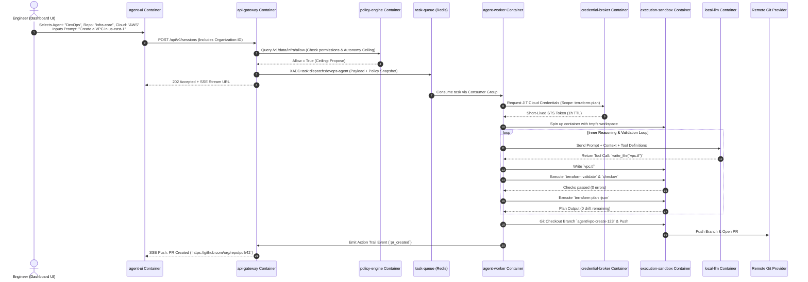

# Infrastructure Agent Architecture Blueprint & Local Setup Guide

> An end-to-end operational blueprint, single-table container reference, directory structure, software stack, sequence workflows, and local deployment guide derived from the 13-chapter reference architecture.

---

## 1. Chapter Implementation Summary & Key Steps

Below is the summary table detailing the core focus, key architectural concepts, and mandatory implementation steps across all 13 chapters of the architecture guide.

| Chapter # & Title | Focus Area | Core Key Concepts | Key Implementation Steps |
| :--- | :--- | :--- | :--- |
| **01. Architecture Overview** | System-wide structural design | • Six core planes: Ingestion, Policy, Execution, Integration, Change Control, Observability<br>• Autonomy dial & ceilings (Off, Observe, Propose, Governed)<br>• Worker statelessness | 1. Implement a unified Signal Router for webhooks, schedules, and chat.<br>2. Build a Policy Engine gate before execution.<br>3. Decouple stateless workers from stateful DBs via queues. |
| **02. Agent Runtime & Orchestration** | Task queuing & execution loops | • SDK selection (Claude Agent SDK, OpenAI, LangChain, Custom)<br>• Consumer groups & PEL recovery<br>• Context compaction & session persistence | 1. Set up double-stream queues (Dispatch & Output streams).<br>2. Implement worker heartbeat monitoring & stuck-task watchdogs.<br>3. Build state recovery using git bundles & session IDs. |
| **03. Tools, CLIs & Skills** | Capability delivery & extension interfaces | • CLI tools vs. typed wrappers<br>• Agent Skills format (progressive disclosure)<br>• MCP & A2A 1.0 protocol standards | 1. Package CLI tools inside sandbox container images.<br>2. Create typed JSON wrappers for high-risk CLI commands.<br>3. Define structured `SKILL.md` files and enforce tool allow/deny lists. |
| **04. Sandboxed Execution** | Runtime isolation & security boundaries | • Container ephemerality & microVM sandboxing<br>• Network egress restrictions<br>• Blocking metadata endpoint (`169.254.169.254`) | 1. Provision ephemeral sandboxes (Docker, Modal, MicroVMs).<br>2. Enforce strict egress rules (block cloud metadata endpoints).<br>3. Implement lease-based orphan sweeper and sandbox recovery. |
| **05. Credential Management** | Just-in-time access control | • "No long-lived credentials in workers" rule<br>• Scoped JIT credential brokering<br>• Dynamic cloud token minting | 1. Build a Credential Broker service separate from workers.<br>2. Set up cloud token exchange (AWS STS, Azure Workload Identity, GCP IAM).<br>3. Restrict generated tokens to short TTLs ($\le 1$ hour) and read-only defaults. |
| **06. The Data Plane** | Knowledge serialization & retrieval | • Five context layers (Cloud, IaC, Security, Cost, Org)<br>• Cloud-to-IaC correlation<br>• Compact Markdown context serialization | 1. Collect and store normalized resources in a central DB.<br>2. Link cloud resource IDs to Terraform state/repo paths.<br>3. Serialize context into compact Markdown for LLM prompt injection. |
| **07. Change Control & GitOps** | Safe infrastructure deployment pipelines | • PR-first workflow constraint<br>• Pre-PR validation & zero-drift loops<br>• Deterministic static checks | 1. Enforce branch creation for all automated changes.<br>2. Run static linters & security scanners (Checkov, TFLint, Conftest).<br>3. Execute `terraform plan` feedback loop up to $N$ iterations before PR creation. |
| **08. Policy & Guardrails** | Access boundaries & automated gates | • Three guardrail layers (Structural, Prompt, Runtime)<br>• Governed Merge/Apply gateways<br>• Natural language policy compilation | 1. Enforce runtime tool allow/deny lists (deny always wins).<br>2. Build server-owned merge/apply gateways with blast-radius limits.<br>3. Generate structural policies (OPA/Rego, SCPs) from markdown rules. |
| **09. Observability & Audit** | System transparency & failure debugging | • Action Trails (event sourcing)<br>• OpenTelemetry GenAI semantic conventions<br>• Automated log redaction | 1. Instrument worker & LLM turns with OpenTelemetry spans.<br>2. Emit immutable Action Trail events to dedicated streams.<br>3. Apply pattern-matching regex redaction for all output logs. |
| **10. Autonomous Operations** | Unattended execution & alert handling | • Four-level autonomy dial (Reactive to Goal-driven)<br>• Durable session goals & single ownership<br>• Multi-channel escalation chains | 1. Implement scheduled triggers (CronJob / EventBridge).<br>2. Set up single-owner dispatch locks & cadence budgets per goal.<br>3. Route alert notifications via Slack, Teams, Email, or PagerDuty. |
| **11. Testing & Hardening** | Verification & vulnerability defense | • Four testing levels (Unit, Trajectory, Adversarial, Evals)<br>• Prompt injection resistance<br>• Concurrency race testing | 1. Write unit tests for skills, tools, and the credential broker.<br>2. Implement trajectory scenario recorders to test multi-turn flows.<br>3. Run adversarial prompt injection tests against IaC files. |
| **12. UX, Usability & Onboarding** | Adoption enablement & tenant boundaries | • Safe defaults by design<br>• Organization-level multi-tenancy<br>• Quick Connect (OIDC / Role delegation) | 1. Enforce organizational boundaries on all DB queries.<br>2. Implement progressive disclosure during onboarding.<br>3. Provide pre-built prompt templates for common IaC tasks. |
| **13. Risk Framework & Checklists** | Promotion ladders & regulatory alignment | • Autonomy promotion ladder<br>• Compliance mapping (NIST AI RMF, OWASP, SOC 2)<br>• Go-live verification checklists | 1. Assess risk matrix to assign initial autonomy levels per use-case.<br>2. Implement shadow-mode evaluation to measure PR merge rates.<br>3. Complete Phase 1–4 go-live security and governance checklists. |

---

## 2. All Containers Reference Table (What Each Container Means)

In a microservice-based AI Agent Architecture, every container performs a **single dedicated duty**. Containers are grouped into distinct network planes to prevent a compromised container from accessing unauthorized components.

Below is the single reference table defining every container in the local/production deployment stack:

| Container Name | Plane / Category | Base Image / Software | Port(s) | Volumes / Storage | Purpose & Detailed Operational Role |
| :--- | :--- | :--- | :--- | :--- | :--- |
| **`agent-ui`** | UX & Onboarding | `node:22-alpine` (Next.js / React) | `3000:3000` | None (Stateless) | **User Portal & Dashboard**: Provides the web interface for engineers to chat with agents, inspect session logs, view generated IaC diffs, configure organization multi-tenancy, and approve/reject actions. |
| **`api-gateway`** | Ingestion & Policy | `python:3.12-slim` (FastAPI) or `node:22-slim` | `8000:8000` | None | **Signal Router & Ingestion Engine**: Accepts incoming webhooks (GitHub/GitLab), scheduled jobs, and UI requests. Validates org-level tenancy filters, evaluates policy ceilings, and dispatches tasks to Redis Streams. |
| **`policy-engine`** | Policy Plane | `openpolicyagent/opa:latest` | `8181:8181` | `./policies:/policies` | **OPA Engine**: Evaluates structural rules (Rego) against requested tool calls, budget limits, and resource modifications before execution occurs. |
| **`task-queue`** | Execution Plane | `redis:7-alpine` | `6379:6379` | `redis-data:/data` | **Message Bus & Event Queue**: Holds `task:dispatch` streams for distributing jobs to workers and `task:output` streams for real-time SSE event streaming back to the UI. |
| **`database`** | Data Plane | `postgres:16-alpine` (with `pgvector`) | `5432:5432` | `postgres-data:/var/lib/postgresql/data` | **System DB & Data Plane Store**: Persists user organizations, session history, action trails, normalized resource inventory, durable goal states, and vector embeddings for documentation lookup. |
| **`credential-broker`** | Integration Plane | Custom Go / Python Microservice | `3000:3000` (Internal only) | None | **JIT Token Minting Service**: The *only* service allowed to talk to long-lived secret stores. Generates short-lived ($\le 1$ hour) STS / OIDC tokens for the sandbox upon validated worker request. |
| **`agent-worker`** | Execution Plane | `python:3.12-slim` / `node:22-slim` | Internal only | None | **Stateless Orchestrator**: Consumes tasks from Redis, manages the multi-turn LLM loop (Prompt $\rightarrow$ LLM $\rightarrow$ Tool Call), handles context compaction, and spawns ephemeral sandbox runtimes. |
| **`execution-sandbox`** | Execution Plane | Ephemeral Container (`Debian` + IaC CLIs) | None (Isolated) | `/tmp`, `/workspace` (tmpfs) | **Isolated Runner**: Ephemeral container where untrusted generated code runs. Contains `terraform`, `aws-cli`, `git`, `checkov`, `tflint`. Network egress is restricted, and `169.254.169.254` is blocked. |
| **`local-llm`** | Model Provider | `ollama/ollama:latest` or `vllm` | `11434:11434` | `ollama-data:/root/.ollama` | **Local Inference Engine**: Serves local AI models (e.g., `qwen2.5-coder`, `llama3.1`) over OpenAI-compatible REST endpoints, keeping reasoning data entirely offline. |
| **`otel-collector`** | Observability | `otel/opentelemetry-collector-contrib` | `4317:4317` (gRPC), `4318:4318` (HTTP) | `./otel-config.yaml` | **Telemetry Aggregator**: Receives OpenTelemetry traces, metrics, and Action Trail events from workers and API servers, parsing and forwarding them to Loki/Tempo/Prometheus. |

---

## 3. Directory & Folder Structure

```
infra-agent-system/
├── docker-compose.yml
├── .env.example
├── README.md
├── packages/
│   ├── api-gateway/            # Ingestion Service & Policy Router
│   │   ├── Dockerfile
│   │   ├── src/
│   │   │   ├── router/
│   │   │   ├── policy/
│   │   │   ├── tenancy/        # Multi-tenancy org middleware
│   │   │   └── main.py
│   │   └── requirements.txt
│   ├── credential-broker/       # JIT Credential Broker Service
│   │   ├── Dockerfile
│   │   └── src/
│   │       ├── aws_sts.ts
│   │       ├── azure_identity.ts
│   │       └── server.ts
│   ├── agent-worker/           # Inner/Outer Loop Execution Worker
│   │   ├── Dockerfile
│   │   └── src/
│   │       ├── agent_loop.ts
│   │       ├── context_compactor.ts
│   │       └── tools/
│   └── agent-ui/               # Next.js Web Portal
│       ├── Dockerfile
│       └── src/
├── sandboxes/
│   └── docker/
│       ├── Dockerfile.sandbox  # Ephemeral sandbox image with Terraform, Checkov, Git
│       └── entrypoint.sh
├── policies/
│   └── infra_guardrails.rego  # Open Policy Agent rules
├── tests/                      # Testing & Hardening suite (Chapter 11)
│   ├── unit/
│   ├── trajectory/
│   └── adversarial/
└── config/
    └── otel-collector-config.yaml
```

---

## 4. Software Stack Selection

* **LLM Engine**: Local Ollama (`qwen2.5-coder:7b`) or remote Claude Agent SDK / OpenAI API.
* **Task Queue**: Redis 7.0 Streams (with Consumer Groups and PEL recovery).
* **Database**: PostgreSQL 16 with `pgvector` for resource graphs & doc retrieval.
* **Policy Engine**: Open Policy Agent (OPA).
* **IaC & Security Tools**: OpenTofu / Terraform 1.17+, Checkov, TFLint, Infracost, Git.
* **Observability**: OpenTelemetry Collector, Prometheus, Grafana, Loki.
* **Testing Framework**: Bun test runner / Jest for Unit, Trajectory, and Adversarial test suites.

---

## 5. End-to-End Execution Sequence ("Create AWS VPC")



---

## 6. Step-by-Step Local Deployment & Verification Guide

### Step 1: Start Core Infrastructure Services
```bash
docker compose up -d postgres redis policy-engine local-llm
```

### Step 2: Download Local LLM Model
```bash
docker exec -it agent-local-llm ollama pull qwen2.5-coder:7b
```

### Step 3: Launch Microservices & Workers
```bash
docker compose up --build -d api-gateway credential-broker agent-worker agent-ui
```

### Step 4: Run Hardening & Trajectory Test Suite (Chapter 11)
```bash
# Run unit, trajectory, and adversarial tests inside the worker runtime
docker compose exec agent-worker bun test
```

### Step 5: Verify Stack Health
```bash
docker compose ps
```
All core containers will show `Up (healthy)`. You can now open `http://localhost:3000` to interact with your local, isolated infrastructure agent system!